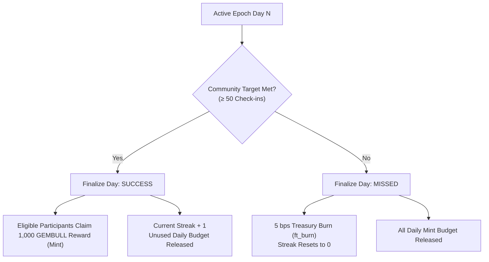

# GemBull

GemBull is a NEAR-native community memecoin whose circulating supply and tokenomics react to a daily on-chain ritual. An eligible account checks in once per 24-hour epoch. A successful community day creates individual reward claims; a missed day burns a fixed slice of the ritual treasury and resets the community streak. The entire state machine lives directly inside the smart contract, not in a private backend.

---

## 🎯 Judge Start Here

* **Track:** `memecoins`
* **Network:** NEAR Testnet
* **Live Contract:** [`gembull-core.testnet`](https://testnet.nearblocks.io/address/gembull-core.testnet)
* **Autonomous Keeper:** [`keeper.gembull-public.testnet`](https://testnet.nearblocks.io/address/keeper.gembull-public.testnet)
* **Hosted dApp:** [https://gembull-testnet.vercel.app](https://gembull-testnet.vercel.app)
* **License:** [MIT](LICENSE)

| Do this | See this | Evidence |
|---|---|---|
| Open the [hosted app](https://gembull-testnet.vercel.app) and scroll to **Ritual** | Current epoch, live check-in progress, on-chain rules, and Testnet source labels | Live contract views (`get_global_state`, `get_rules`), not simulated metrics |
| Open **Supply** and **Epoch History** | On-chain supply, verified finalized epochs, and live NEP-297 ritual event stream | Contract queries and `/api/ritual/events` feed indexing `ft_mint`, `ft_burn`, and check-ins |
| Run `pnpm verify:testnet` from repo root | Metadata, rules, supply bounds, code hash, and upgrade-key report | Direct JSON-RPC finality verification against NEAR Testnet |
| Run `python scripts/simulate_60_days.py --check` | 180 verified mathematical simulation rows | Deterministic model checking optimistic, base, and pessimistic outcomes |
| Connect a Testnet wallet, register storage, and **Check in now** | Wallet signs `check_in`; app refreshes account status and epoch count at finality | [Wallet Guide](docs/TESTNET_USER_GUIDE.md); 0.05 Testnet NEAR attached for storage |
| Inspect autonomous epoch finalization | Background keeper settles completed epochs sequentially | [Keeper Service](services/keeper-bot/); runs 24/7 in Docker with multi-RPC failover |

**Observed On-Chain Testnet Evidence:**
* Genesis supply of 1,000,000,000 GEMBULL initialized with 150,000,000 allocated to the ritual treasury.
* **Epoch Day 0 Finalized:** Settled on-chain at block `277534032`. With target missed, the contract burned 5 bps of the treasury (**75,000 GEMBULL**) via standard `ft_burn` event, reducing treasury to `149,925,000 GEMBULL` and total supply to `999,925,000 GEMBULL`.
* **Active Epoch:** Day 1 is active on Testnet, tracked in real-time by the web app and keeper worker.

---

## ⚡ Architecture & Daily Ritual State Machine

The ritual operates on a fixed deterministic 24-hour cycle enforced by the NEAR runtime timestamp:



### Ritual Parameters (Contract Enforced)

These rules are fixed at contract initialization. There are no public admin or owner setters capable of mutating them:

| Parameter | Value | Contract Enforcement |
|---|---:|---|
| **Epoch Duration** | 24 hours (`86,400s`) | Calculated from genesis timestamp via `env::block_timestamp()` |
| **Community Target** | 50 accounts | Minimum check-ins required for a successful epoch |
| **Minimum Holding** | 1,000 GEMBULL | Account must hold at least 1,000 GEMBULL to check in |
| **Participant Cap** | 200 accounts | Maximum reward claims per successful epoch (max 200,000 GEMBULL/day) |
| **Reward per Check-in** | 1,000 GEMBULL | Minted individually upon claim after successful finalization |
| **Treasury Miss Burn** | 5 bps (0.05%) | Burned from contract ritual treasury on missed epoch |
| **Supply Cap** | 1,050,000,000 GEMBULL | Hard ceiling; once remaining capacity < 200,000, ritual terminates |

---

## 🤖 Autonomous Keeper Bot (`services/keeper-bot`)

Because smart contracts on NEAR cannot execute transactions on their own without external gas, GemBull implements a **Permissionless Settlement** architecture supported by an autonomous keeper service:

* **Location:** [`services/keeper-bot/`](services/keeper-bot/)
* **Runtime:** Containerized Node.js service running 24/7 on VPS via Docker Compose (`node:22-alpine`).
* **Wallet:** Dedicated testnet account [`keeper.gembull-public.testnet`](https://testnet.nearblocks.io/address/keeper.gembull-public.testnet) funded with 3 NEAR.
* **RPC Failover:** Automatic fallback between FastNear, Official NEAR Testnet RPC, and NearData RPC.
* **Mechanism:**
  1. Polls `get_global_state()` every 60 seconds.
  2. Compares `current_day_id` with `last_finalized_day`.
  3. If unfinalized epochs exist (`current_day_id > last_finalized_day + 1`), automatically triggers `finalize_day({ day_id })` sequentially.
  4. Web dashboard also maintains a fallback settlement action in case keepers are offline.

---

## 💻 Run Locally

### 1. Web Application

```bash
# Install dependencies from root
pnpm install

# Configure environment
cp apps/web/.env.example apps/web/.env.local

# Run Next.js development server
pnpm dev
```

Open [http://localhost:3000](http://localhost:3000) to view the ritual dashboard.

Frontend commands from root:
```bash
pnpm typecheck   # Typecheck with TypeScript
pnpm lint        # Lint web application with ESLint
pnpm build       # Production Next.js build
```

### 2. Verify On-Chain Contract & Simulation

```bash
# Verify deployed Testnet contract at finality
pnpm verify:testnet

# Run deterministic 60-day supply simulation
python scripts/simulate_60_days.py --check
```

### 3. Run Keeper Bot Locally

```bash
cd services/keeper-bot

# Single-run check (read-only monitor mode if no private key is set)
node keeper.mjs --once

# Continuous monitor loop
npm start
```

---

## 🧪 Smart Contract Verification

The smart contract is written in Rust using `near-sdk` v5.30.1:

```bash
cd contracts/gembull-core

# Run 20 unit tests covering all ritual edge cases
cargo test --lib

# Build Wasm binary
cargo near build non-reproducible-wasm --no-abi

# Run Linux Sandbox integration tests (requires Linux or Docker)
cargo test --test ritual_sandbox
```

All 20 unit tests pass, verifying:
* Target hit vs missed outcomes
* Exact 5 bps treasury burn calculation and rounding
* Supply cap reservation and release
* Sequential settlement requirements (rejecting skipped or premature epochs)
* Single check-in and single claim enforcement per account per epoch
* NEP-141, NEP-145, and NEP-148 compliance with NEP-297 event logging

---

## 🗺️ Repository Structure

```text
├── contracts/
│   └── gembull-core/         # NEP-141 token and ritual state machine in Rust
├── apps/
│   └── web/                  # Next.js 16 (Turbopack) ritual dApp and live event feed
├── services/
│   └── keeper-bot/           # 24/7 Autonomous keeper service (Node.js + Docker)
├── scripts/
│   ├── verify_gembull_testnet.mjs  # On-chain RPC verification script
│   ├── distribute_testnet.mjs      # Testnet token distribution helper
│   └── simulate_60_days.py         # Deterministic supply simulation script
└── docs/                     # PRD, Tokenomics, Architecture, Test Plan, and Audit
```

---

## 📄 License

This repository is licensed under the [MIT License](LICENSE).
