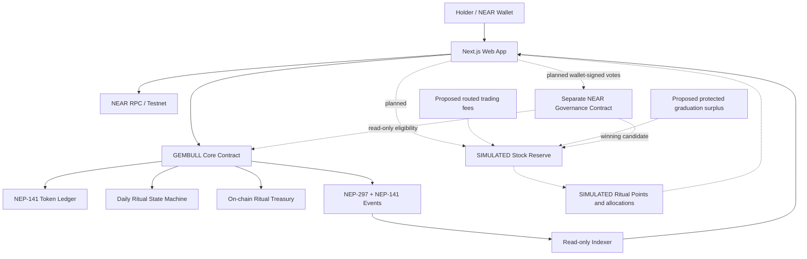
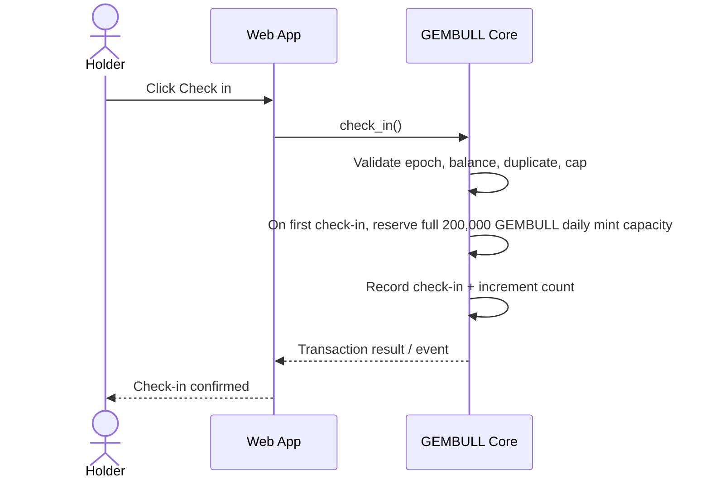
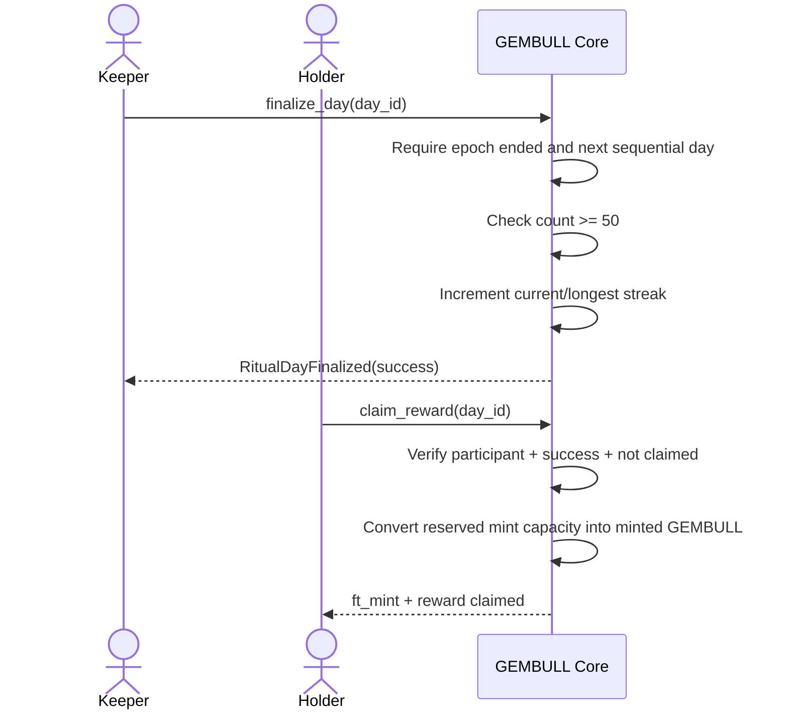

# Technical Architecture

## 1. Architecture principles

- NEAR is the source of truth for GEMBULL supply, check-ins, epoch results, streaks, rewards, and ritual treasury burns.
- Backend services are not allowed to modify ritual state.
- Stock-reserve accounting is isolated from the ritual token balance and liquidity inventory.
- The stock integration is a mock adapter in the hackathon MVP.
- The system must remain usable for the core ritual if stock quote or broker services are unavailable.

## 2. Logical architecture



## 3. Components

### 3.1 `gembull-core`

One Rust contract combines:
- NEP-141 fungible token behavior;
- NEP-145 storage management;
- NEP-148 metadata;
- immutable ritual parameters;
- check-in records and epoch counters;
- per-account reward entitlements/claims;
- current/longest streak state;
- ritual treasury balance and missed-day burn;
- NEP-141 and custom NEP-297 event emission.

Combining the token and ritual mechanic ensures the supply-changing logic is not delegated to a replaceable backend.

### 3.2 Planned mock settlement asset

A clearly labeled Testnet-only mock asset may fund reserve simulations. The settlement asset and route remain open decisions; no stock asset contract has been deployed.

### 3.3 Planned stock reserve

Tracks proposed routed-fee and protected graduation-surplus inflows separately, records simulated batches, and exposes reserve/batch views. Its ledger must be independent of GEMBULL's ritual treasury. No such contract is currently deployed.

### 3.4 Planned Ritual Points and allocation ledger

One non-transferable point per valid check-in is the v0.2 proposal. A fixed snapshot and rolling 5-of-7 eligibility calculation would weight simulated allocations. Neither points nor allocation ledger exists today, and the revised MVP does not mint a custom stock receipt token.

### 3.4a Planned community governance

A separate Testnet contract would accept permissionless candidate nominations, verify wallet-signed voter eligibility against on-chain state, record ballots, tally, and allow anyone to finalize after the voting window. It must have no admin winner override. Candidate metadata and simulated recipient views are separate from actual equity rights. Voting weight, eligibility verification, storage/deposit bounds, and upgrade authority are open design gates in [COMMUNITY_STOCK_GOVERNANCE.md](COMMUNITY_STOCK_GOVERNANCE.md). No such contract is deployed.

### 3.5 Stock simulator service

A Node.js service with:
- static or licensed market-data adapter;
- deterministic mock broker execution;
- batch-result generator;
- mock issuer signer/account integration;
- no private keys committed to the repository.

The simulator is never authoritative for votes, winners, or recipient entitlement. Any eventual recipient calculation must be reproducible from frozen, verifiable state rather than a team-edited file.

Market prices are informational. Custody confirmation is a separate mock event and must have a `SIMULATED` label.

### 3.6 Frontend

Next.js + TypeScript + Tailwind. Uses a supported NEAR wallet integration and calls the contract directly for all ritual writes. The frontend reads rule constants from `get_rules()` rather than duplicating values.

### 3.7 Indexer

Read-only event consumer. It indexes NEP-141 events (`ft_mint`, `ft_burn`, `ft_transfer`) and custom ritual events. It can improve history queries but is never authoritative; the frontend should be able to read core state directly from contract view methods.

## 4. Proposed repository layout

```text
contracts/
  gembull-core/
  mock-usdc/
  stock-vault/
  stock-governance/       # proposed; separate from gembull-core
  ritual-points/          # planned, if contract-backed points are chosen
apps/
  web/
services/
  stock-simulator/
  event-indexer/
scripts/
  simulate_60_days.py
```

Codex may adjust the workspace layout after inspecting current repository state, but it must keep the component boundaries and trust boundaries above.

## 5. Contract call flows

### 5.1 Check-in



### 5.2 Successful settlement and claim



### 5.3 Missed settlement

```mermaid
sequenceDiagram
    actor Keeper
    participant C as GEMBULL Core
    Keeper->>C: finalize_day(day_id)
    C->>C: Require epoch ended and next sequential day
    C->>C: Check count < 50
    C->>C: Burn 5 bps of remaining ritual treasury
    C->>C: Release reward reservations
    C->>C: Reset current streak; preserve longest streak
    C-->>Keeper: RitualDayFinalized(failed) + ft_burn
```

### 5.4 Planned stock reserve simulation

1. Record simulated routed trading-fee and protected graduation-surplus contributions in separate source ledgers.
2. Aggregate an eligible simulated acquisition batch without using the ritual treasury or protected LP/refund assets.
3. Produce a clearly labeled mock execution record; no live broker or issuer attestation is implied.
4. Calculate points and active-holder eligibility from a defined, auditable start date and fixed snapshot.
5. Show simulated, points-weighted allocations with a persistent no-equity disclaimer. No receipt token is minted.

## 6. Clock and epoch model

- Contract stores `launch_timestamp_ns = env::block_timestamp()` at initialization.
- `day_id = floor((block_timestamp_ns - launch_timestamp_ns) / EPOCH_DURATION_NS)`.
- All day calculations are based on chain timestamps, not browser clocks.
- Settlement must be sequential: `day_id == last_finalized_day + 1`.
- A permissionless settlement method allows any account to finalize a completed epoch.
- The UI may call settlement when it detects an ended unfinalized epoch, but does not own the right to settle.

## 7. Technology choices

| Layer | Choice | Notes |
|---|---|---|
| Smart contracts | Rust + current `near-sdk` v5.x | Follow official NEAR agent skill |
| FT standards | NEP-141 + NEP-145 + NEP-148 | Do not roll a custom FT interface |
| Events | NEP-141 + NEP-297 | Machine-readable event log |
| Local testing | NEAR Sandbox | Include fast-forward/time-travel tests |
| Frontend | Next.js + TypeScript + Tailwind | Keep chain writes in wallet/client |
| Wallet | NEAR Wallet Selector or current recommended NEAR wallet integration | Verify compatibility at implementation time |
| Backend | Node.js / TypeScript | Mock broker + read-only indexing only |
| Database | PostgreSQL/Supabase optional | Cache/index only; chain is source of truth |
| Hosting | Vercel + a small service host | Testnet demo only |

## 8. Trust boundaries

| Boundary | Trusted for | Not trusted for |
|---|---|---|
| GEMBULL contract | Supply, ritual, treasury burn, check-in eligibility | Human uniqueness |
| Wallet signer | User authorization | Human identity beyond account control |
| Indexer/backend | Event indexing, presentation | Ritual decisions or token mint authority |
| Stock quote API | Quoted market price and timestamp | Proof of stock ownership |
| Mock broker/issuer | Demonstration only | Real custody, legal claims, redemption |
| Frontend | User interaction | Enforcing protocol rules |
