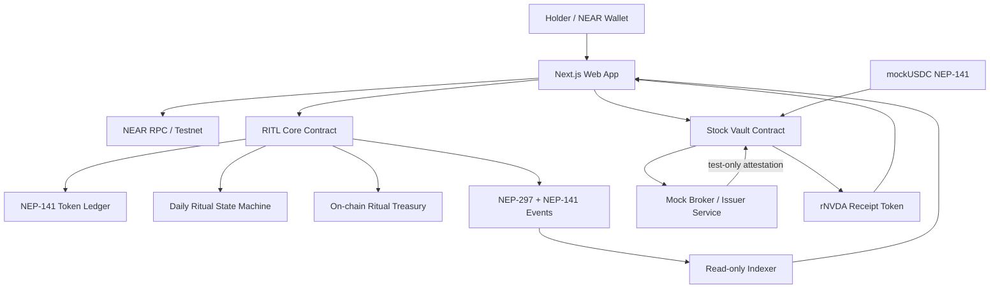
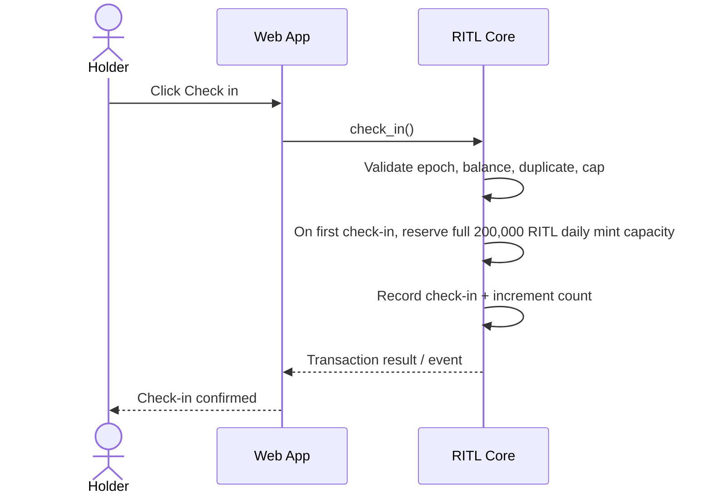
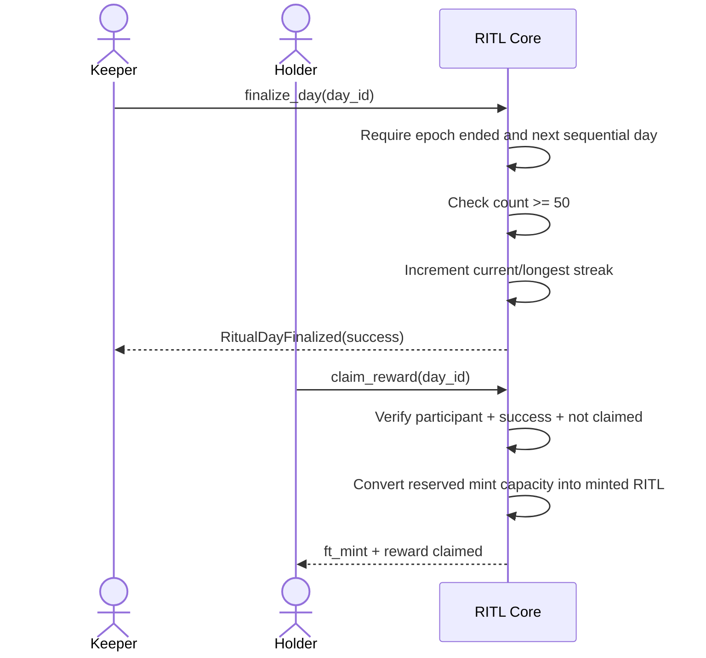

# Technical Architecture

## 1. Architecture principles

- NEAR is the source of truth for RITL supply, check-ins, epoch results, streaks, rewards, and ritual treasury burns.
- Backend services are not allowed to modify ritual state.
- Stock-reserve accounting is isolated from the ritual token balance and liquidity inventory.
- The stock integration is a mock adapter in the hackathon MVP.
- The system must remain usable for the core ritual if stock quote or broker services are unavailable.

## 2. Logical architecture



## 3. Components

### 3.1 `ritl-core`

One Rust contract combines:
- NEP-141 fungible token behavior;
- NEP-145 storage management;
- NEP-148 metadata;
- immutable ritual parameters;
- check-in records and epoch counters;
- per-account reward entitlements/claims;
- current/longest streak state;
- ritual treasury balance and missed-day burn;
- NEP-141 and custom NEP-297 event emission.

Combining the token and ritual mechanic ensures the supply-changing logic is not delegated to a replaceable backend.

### 3.2 `mock-usdc`

A clearly labeled Testnet-only NEP-141 faucet token used to fund stock-reserve demonstrations. It must not be confused with real USDC or have mainnet deployment defaults.

### 3.3 `stock-vault`

Receives mockUSDC contributions, records contribution batches, enforces batch state transitions, and exposes reserve/batch views. This contract is independent of RITL's ritual treasury.

### 3.4 `receipt-token`

A separate NEP-141 token with symbol `rNVDA` and metadata naming it a simulated receipt. Only the fixed mock issuer / stock-vault authority may mint it after a valid test attestation. It is not a representation of real equity.

### 3.5 Stock simulator service

A Node.js service with:
- static or licensed market-data adapter;
- deterministic mock broker execution;
- batch-result generator;
- mock issuer signer/account integration;
- no private keys committed to the repository.

Market prices are informational. Custody confirmation is a separate mock event and must have a `SIMULATED` label.

### 3.6 Frontend

Next.js + TypeScript + Tailwind. Uses a supported NEAR wallet integration and calls the contract directly for all ritual writes. The frontend reads rule constants from `get_rules()` rather than duplicating values.

### 3.7 Indexer

Read-only event consumer. It indexes NEP-141 events (`ft_mint`, `ft_burn`, `ft_transfer`) and custom ritual events. It can improve history queries but is never authoritative; the frontend should be able to read core state directly from contract view methods.

## 4. Proposed repository layout

```text
contracts/
  ritl-core/
  mock-usdc/
  stock-vault/
  receipt-token/
apps/
  web/
services/
  stock-simulator/
  event-indexer/
scripts/
  simulate_60_days.py
```

Codex may adjust the workspace layout after inspecting current repository state, but it must keep the component boundaries and trust boundaries above.

## 5. Contract call flows

### 5.1 Check-in



### 5.2 Successful settlement and claim



### 5.3 Missed settlement

```mermaid
sequenceDiagram
    actor Keeper
    participant C as RITL Core
    Keeper->>C: finalize_day(day_id)
    C->>C: Require epoch ended and next sequential day
    C->>C: Check count < 50
    C->>C: Burn 5 bps of remaining ritual treasury
    C->>C: Release reward reservations
    C->>C: Reset current streak; preserve longest streak
    C-->>Keeper: RitualDayFinalized(failed) + ft_burn
```

### 5.4 Stock reserve simulation

1. User deposits mockUSDC to `stock-vault` through NEP-141 `ft_transfer_call`.
2. Vault records contributor and batch amount.
3. When a batch meets its configured test threshold, the mock broker produces a simulated fill result.
4. The designated mock issuer calls the attestation method from its authorized test account.
5. Vault marks the batch as simulated-executed and authorizes receipt minting.
6. Receipt contract mints `rNVDA`; UI displays the simulation disclaimer.

## 6. Clock and epoch model

- Contract stores `launch_timestamp_ns = env::block_timestamp()` at initialization.
- `day_id = floor((block_timestamp_ns - launch_timestamp_ns) / EPOCH_DURATION_NS)`.
- All day calculations are based on chain timestamps, not browser clocks.
- Settlement must be sequential: `day_id == last_finalized_day + 1`.
- A permissionless settlement method allows any account to finalize a completed epoch.
- The UI may call settlement when it detects an ended unfinalized epoch, but does not own the right to settle.

## 7. Technology choices

| Layer | Choice | Notes |
|---|---|---|
| Smart contracts | Rust + current `near-sdk` v5.x | Follow official NEAR agent skill |
| FT standards | NEP-141 + NEP-145 + NEP-148 | Do not roll a custom FT interface |
| Events | NEP-141 + NEP-297 | Machine-readable event log |
| Local testing | NEAR Sandbox | Include fast-forward/time-travel tests |
| Frontend | Next.js + TypeScript + Tailwind | Keep chain writes in wallet/client |
| Wallet | NEAR Wallet Selector or current recommended NEAR wallet integration | Verify compatibility at implementation time |
| Backend | Node.js / TypeScript | Mock broker + read-only indexing only |
| Database | PostgreSQL/Supabase optional | Cache/index only; chain is source of truth |
| Hosting | Vercel + a small service host | Testnet demo only |

## 8. Trust boundaries

| Boundary | Trusted for | Not trusted for |
|---|---|---|
| RITL contract | Supply, ritual, treasury burn, check-in eligibility | Human uniqueness |
| Wallet signer | User authorization | Human identity beyond account control |
| Indexer/backend | Event indexing, presentation | Ritual decisions or token mint authority |
| Stock quote API | Quoted market price and timestamp | Proof of stock ownership |
| Mock broker/issuer | Demonstration only | Real custody, legal claims, redemption |
| Frontend | User interaction | Enforcing protocol rules |
